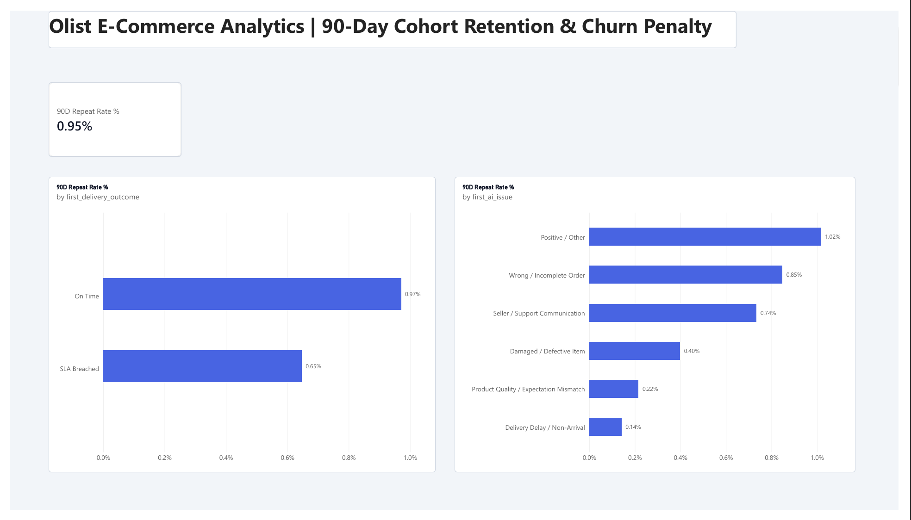

# E-Commerce Voice of Customer (VoC) & Logistics SLA Analytics Pipeline

An end-to-end analytics engineering and AI text-classification pipeline built on the Brazilian Olist E-Commerce dataset (**99,092 orders**; **R$ 15.94M GMV**). Combines **MySQL**, **Python (Pydantic + Gemini Structured Outputs)**, **Horvitz-Thompson weighted survey estimation**, and a **3-page Power BI executive dashboard** to quantify how delivery SLA breaches and operational failures correlate with 1–2 star reviews and 90-day repeat purchasing.

---

## Key Analytical Findings

- **Logistics SLA Impact on Customer Satisfaction:** Across **99,092 orders** (`R$ 15.94M` GMV; defined as item price + freight, tracked separately from collected payment value), the overall SLA breach rate across all orders is **6.79%** and the low-rating (`1★–2★`) rate is **14.63%**. However, low ratings surge from **9.25%** on `On Time` deliveries to **62.42%** when `SLA Breached` and **80.66%** when `Never Arrived`.
- **Volume vs. Revenue Exposure (`R$ 3.00M` Weighted Associated GMV):**
  - **Delivery Delay / Non-Arrival** is the #1 complaint by volume (**14.09%** of the 40,494 written-review population), followed by **Wrong / Incomplete Order** (**10.30%**).
  - By expansion-weighted GMV associated with complaint-affected orders, **Wrong / Incomplete Order** overtakes delivery delays (**R$ 0.99M** vs. **R$ 0.97M**) because higher-AOV orders suffer disproportionately from fulfillment and picking errors.
- **90-Day Observational Repeat Purchase Retention (`N = 73,075` First Delivered-Order Cohort Customers):**
  - Overall 90-day repeat purchase rate sits at **0.95%**, dropping from **0.98%** after an `On Time` first delivery to **0.65%** after an `SLA Breached` first delivery (**34% relative drop**).
  - Across the survey-weighted AI review cohort (`n = 3,620` sampled cohort customers; `is_ai_sampled = 1`), observed 90-day repeat purchasing stands at **1.11%** for `Positive / Other` reviews (`2.35%` for `Seller / Support Communication`, where responsive recovery can retain buyers) and **1.16%** for `Wrong / Incomplete Order` (often replacement re-orders), compared to **0.51%** for `Delivery Delay / Non-Arrival`, **0.17%** for `Damaged / Defective Item`, and **0.16%** for `Product Quality / Expectation Mismatch`.

---

## Executive Dashboard Preview

### 1. Executive Overview & Logistics SLA Impact


### 2. AI Voice of Customer (Weighted Root Causes & Associated GMV)


### 3. 90-Day Cohort Retention (Observational)


---

## Architecture & Engineering Decisions

1. **Relational Data Warehouse & Grain-Safe Modeling (`MySQL`)**
   - Loaded and indexed **7 raw relational tables** (`sql/01_create_tables.sql`, `src/01_load_data.py`), audited anomalies (`sql/02_data_audit.sql`), and built **5 analytical & BI views** (`sql/03_clean_views.sql`, `sql/05_audit_and_pbi_views.sql`) into `vw_order_master` (**99,092 orders**), pre-aggregating `raw_order_items` and `raw_order_payments` to the order grain prior to joining to prevent multi-item / split-payment fan-out and deduplicating multi-review orders using customer `review_creation_date`.
   - Engineered delivery SLA outcomes (`On Time`, `SLA Breached`, `Never Arrived`, `days_late`), regional macro-groupings, and a delivery-anchored 90-day cohort retention view (`vw_customer_cohort_90d`, **73,075 unique customers anchored on their first delivered order** with a full 90-day observation window prior to `2018-08-31`), strictly comparing post-delivery purchase timestamps (`order_purchase_timestamp > first_delivery_ts`) and evaluating 7-day split-basket orders (`Days 0–6`) independently from 90-day repeat orders (`Days 7–90`).

2. **LLM Structured Classification & Horvitz-Thompson Weighting (`Python` + `Gemini API`)**
   - Sorted the **40,494 written-comment population** deterministically by `(review_score, order_id)` and drew a reproducible star-stratified sample (**5,000 written Portuguese reviews**: 1,000 per star rating `1★–5★`).
   - Built an idempotent, checkpointed micro-batching pipeline (`src/02_classify_reviews.py`) with **Pydantic schema enforcement**, exact batch `order_id` completeness assertions, fail-loud retry exhaustion, and multi-model fallback (`gemini-3.5-flash-lite` / `gemini-3.8-flash` / `gemini-4-hydrogen`) to classify reviews into 6 mutually exclusive operational categories.
   - Evaluated classification alignment on a **100-review human-audit slice (`is_dev_set = 1`, randomly sampled from the 5,000-review frame)** blindly annotated by the author (`data/processed/dev_set_audit_100.csv`) and scored directly against MySQL `ai_review_tags`, achieving **98.0% overall human-audit agreement (98/100)** (`python src/04_audit_dev_set.py --score`).
   - Applied inverse-probability stratum weights (`sample_weight = N_stratum / n_stratum`) to project unbiased population complaint shares, associated GMV, and survey-weighted AI-issue repeat rates across all 40,494 written reviews.

3. **Executive BI Semantic Model (`Power BI Desktop`)**
   - Built a 3-table `1:1` single-direction semantic model (`vw_pbi_orders`, `vw_pbi_voc_weighted`, `vw_pbi_cohort_retention`) with 11 custom DAX measures (including Horvitz-Thompson survey-weighted retention) and a custom JSON report theme (`powerbi/olist_executive_theme.json`).

---

## Methodological Scope & Limitations

- **Observational Association vs. Causality:** Inverse-probability sampling weights correct for the equal-allocation star-stratified sampling design, but they do not control for confounding variables (such as product category, price tier, or buyer intent). Differences in 90-day repeat purchasing across issue categories represent weighted observational associations rather than causal treatment effects.
- **First Delivered-Order Cohort & Repeat Definition:** `vw_customer_cohort_90d` anchors each customer (`customer_unique_id`) on their first `delivered` order (`delivered_seq = 1`) rather than first-ever placed order (e.g., if a customer had an earlier canceled attempt), and defines 90-day repeat purchasing as placing a subsequent non-canceled, non-unavailable order within `Days 7–90` post-delivery.
- **Human-Audit Scope:** The 100-review audit validates overall prompt-taxonomy alignment (`98.0%` agreement across 100 blindly labeled examples randomly drawn from the 5,000-review sample), rather than serving as a large-scale category-by-category benchmark; rare classes (e.g., `Seller / Support Communication`, `n = 3`) carry wider uncertainty.
- **Associated GMV vs. Realized Financial Loss:** Olist public data does not include refund, return-shipping, or chargeback ledgers. `Weighted Associated GMV` (`R$ 3.00M`) measures total order value exposed to complaint-affected orders, not net refunded revenue.
- **Loader Atomicity:** `src/01_load_data.py` truncates and reloads raw tables sequentially; an interrupted run requires re-running the loader from a clean state.

---

## Reproducibility & Setup

```bash
# 1. Clone repository & install dependencies
git clone [https://github.com/sharansergio-creator/olist-voc-project.git](https://github.com/sharansergio-creator/olist-voc-project.git)
cd olist-voc-project
pip install -r requirements.txt

# 2. Configure environment variables
cp .env.example .env
# Add your GEMINI_API_KEY and MYSQL_PASSWORD to .env

# 3. Initialize MySQL schema, load data, and run LLM classification
mysql -u root -p < sql/01_create_tables.sql
python src/01_load_data.py
mysql -u root -p < sql/02_data_audit.sql
mysql -u root -p < sql/03_clean_views.sql
mysql -u root -p < sql/04_create_ai_table.sql
python src/02_classify_reviews.py
mysql -u root -p < sql/05_audit_and_pbi_views.sql

# 4. Verify human-audit agreement & export Power BI CSVs
python src/04_audit_dev_set.py --score
python src/03_export_for_pbi.py
```

---

## Repository Structure

```text
olist-voc-project/
├── assets/
│   ├── page1_executive_overview.png
│   ├── page2_ai_voc.png
│   └── page3_cohort_retention.png
├── data/
│   └── processed/
│       ├── dev_set_audit_100.csv
│       ├── vw_pbi_cohort_retention.csv
│       ├── vw_pbi_orders.csv
│       └── vw_pbi_voc_weighted.csv
├── powerbi/
│   ├── olist_executive_theme.json
│   └── olist_voc_dashboard.pbix
├── sql/
│   ├── 01_create_tables.sql
│   ├── 02_data_audit.sql
│   ├── 03_clean_views.sql
│   ├── 04_create_ai_table.sql
│   └── 05_audit_and_pbi_views.sql
├── src/
│   ├── 01_load_data.py
│   ├── 02_classify_reviews.py
│   ├── 03_export_for_pbi.py
│   └── 04_audit_dev_set.py
├── .env.example
├── .gitignore
├── README.md
└── requirements.txt
```