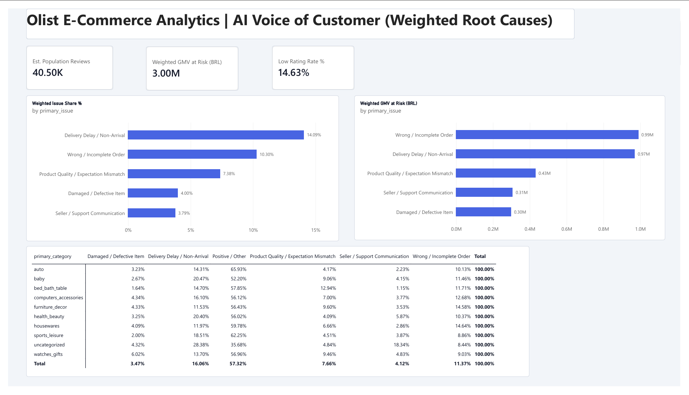

# E-Commerce Voice of Customer (VoC) & Logistics SLA Analytics Pipeline

An end-to-end analytics engineering and AI text-classification pipeline built on the Brazilian Olist E-Commerce dataset (**99,092 orders**; **R$ 15.94M GMV**). Combines **MySQL**, **Python (Pydantic + Gemini Structured Outputs)**, **Horvitz-Thompson weighted survey estimation**, and a **3-page Power BI executive dashboard** to quantify how delivery SLA breaches and operational failures drive 1–2 star reviews and suppress 90-day repeat purchases.

---

## Key Analytical Findings

- **Logistics SLA Impact on Customer Satisfaction:** Across 99,092 orders (R$ 15.94M GMV), the overall SLA breach rate is **6.79%** and low-rating (`1★–2★`) rate is **14.63%**. However, low ratings jump from **9.25%** on `On Time` deliveries to **62.42%** when `SLA Breached` and **80.66%** when `Never Arrived`.
- **Volume vs. Revenue Exposure (`R$ 3.00M` Weighted GMV at Risk):**
  - **Delivery Delay / Non-Arrival** is the #1 complaint by volume (**14.09%** of all written reviews), followed by **Wrong / Incomplete Order** (**10.30%**).
  - By revenue exposure, **Wrong / Incomplete Order** overtakes delivery delays (**R$ 0.99M** vs. **R$ 0.97M** weighted GMV at risk) because higher-AOV orders suffer disproportionately from fulfillment and picking errors.
- **90-Day Repeat Purchase Churn Penalty:** Baseline 90-day repeat purchase rate sits at **0.95%** overall (**1.02%** for `Positive / Other` first-order reviews), drops to **0.65%** after an `SLA Breached` delivery, and collapses to **0.22%** after a `Product Quality / Expectation Mismatch` and **0.14%** after a `Delivery Delay / Non-Arrival` (~86% relative churn penalty).

---

## Executive Dashboard Preview

### 1. Executive Overview & Logistics SLA Impact


### 2. AI Voice of Customer (Weighted Root Causes & GMV at Risk)


### 3. 90-Day Cohort Retention & Churn Penalty


---

## Architecture & Engineering Decisions

1. **Relational Data Warehouse & Grain-Safe Modeling (`MySQL`)**
   - Cleaned and normalized 9 relational tables into `vw_order_master` (99,092 orders), pre-aggregating `order_items` and `order_payments` to the order grain prior to joining to prevent multi-item/split-payment revenue fan-out.
   - Engineered delivery SLA outcomes (`On Time`, `SLA Breached`, `Never Arrived`, `days_late`), regional macro-groupings, and a delivery-anchored 90-day cohort retention view (`vw_customer_cohort_90d`, 73,032 eligible first-time buyers, filtering out 7-day split-basket checkouts).

2. **LLM Structured Classification & Horvitz-Thompson Weighting (`Python` + `Gemini API`)**
   - Drew a deterministic star-stratified sample (**5,000 written Portuguese reviews**: 1,000 per star rating `1★–5★`) from the 40,496 written-comment population.
   - Built an idempotent, checkpointed micro-batching pipeline (`src/02_classify_reviews.py`) with **Pydantic schema enforcement** and multi-model fallback (`gemini-3.5-flash-lite` / `gemini-3.8-flash` / `gemini-4-hydrogen`) to classify reviews into 6 mutually exclusive operational categories (balancing free-tier RPD/RPM rate limits against batch throughput).
   - Validated classification quality against a **100-review human-audited holdout set (`is_dev_set = 1`)**, achieving **98.0% exact-match accuracy (98/100)** (`python src/04_audit_dev_set.py --score`).
   - Applied exact inverse-probability stratum weights (`sample_weight = N_stratum / n_stratum`) to project unbiased population complaint rates and GMV at risk across all 40,496 reviews.

3. **Executive BI Semantic Model (`Power BI Desktop`)**
   - Built a 3-table `1:1` single-direction semantic model (`vw_pbi_orders`, `vw_pbi_voc_weighted`, `vw_pbi_cohort_retention`) with 8 custom DAX measures and a custom JSON report theme (`powerbi/olist_executive_theme.json`).

---

## Reproducibility & Setup

```bash
# 1. Clone repository & install dependencies
git clone https://github.com/sharansergio-creator/olist-voc-project.git
cd olist-voc-project
pip install -r requirements.txt

# 2. Configure environment variables
cp .env.example .env
# Add your GEMINI_API_KEY and MYSQL_PASSWORD to .env

# 3. Verify holdout audit accuracy
python src/04_audit_dev_set.py --score
```

---

## Repository Structure

```text
olist-voc-project/
├── assets/
│   ├── page1_executive_overview.png
│   ├── page2_ai_voc.png
│   └── page3_cohort_retention.png
├── data/
│   └── processed/
│       ├── dev_set_audit_100.csv
│       ├── vw_pbi_cohort_retention.csv
│       ├── vw_pbi_orders.csv
│       └── vw_pbi_voc_weighted.csv
├── powerbi/
│   ├── olist_executive_theme.json
│   └── olist_voc_dashboard.pbix
├── sql/
│   ├── 01_create_tables.sql
│   ├── 02_data_audit.sql
│   ├── 03_clean_views.sql
│   ├── 04_create_ai_table.sql
│   └── 05_audit_and_pbi_views.sql
├── src/
│   ├── 01_load_data.py
│   ├── 02_classify_reviews.py
│   ├── 03_export_for_pbi.py
│   └── 04_audit_dev_set.py
├── .env.example
├── .gitignore
├── README.md
└── requirements.txt
```